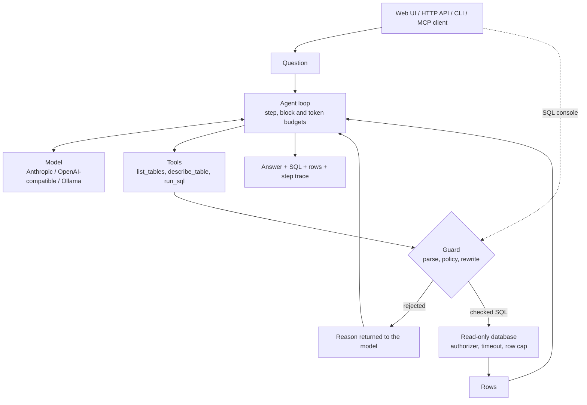

# Architecture

## Modules

| module | role |
|---|---|
| `datagen.py` | deterministic synthetic e-commerce database (5 tables, 12,000 orders) |
| `schema.py` | introspection, column descriptions, sample values, derived policy |
| `guard.py` | AST validation and rewrite of model-written SQL |
| `db.py` | read-only SQLite connection with authorizer, time limit and row cap |
| `tools.py` | the three tools and how their output is shown to the model |
| `llm.py` | Anthropic and OpenAI-compatible clients with tool calling, retries, scripted test model |
| `agent.py` | the loop, budgets, step records, optional JSONL traces |
| `evaluate.py` | execution-accuracy scoring and the guard attack evaluation |
| `api.py`, `static/` | FastAPI service and the web UI |
| `mcp_server.py` | the same tools over the Model Context Protocol |

## One question, end to end

1. The agent sends the question, the schema and the business definitions to the model.
2. The model calls `run_sql`. The guard parses the query, checks it, rewrites it, and the
   regenerated SQL is executed on a read-only connection.
3. The model sees the rows (the first 40) or the rejection reason, and either fixes the query
   or answers. Each step is recorded.
4. The result keeps the full capped row set from the last successful query, so the answer
   can be checked against the data it came from.

## Stopping conditions

The run ends with one of: `ok`, `no_query` (answered without a successful query),
`max_steps`, `blocked_limit` (too many rejected queries), `token_budget`, `model_error`.
